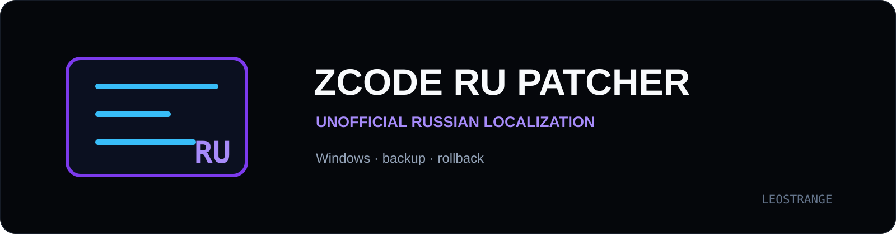
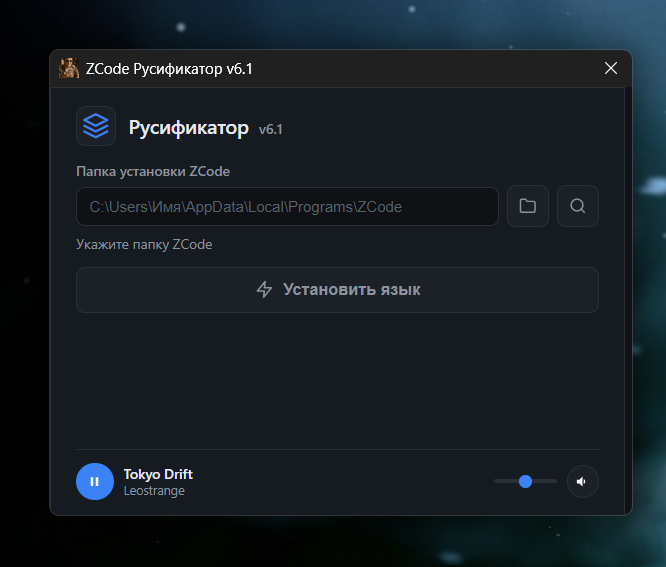

<p align="center"></p>

<p align="center"><b>Неофициальная русификация ZCode под Windows.</b><br/>Патчер устанавливает русский интерфейс, создаёт резервную копию и умеет откатывать изменения.</p>

<p align="center"><code>Windows</code> · <code>Electron</code> · <code>Node.js</code> · <code>MIT</code> · <code>Community project</code></p>

<p align="center"><a href="https://github.com/Leostrange/zcode-ru-patcher/releases/tag/v6.4.0"><b>Скачать v6.4.0</b></a> · <a href="assets/Russian_UI_ZCode.mp4">MP4-демо</a> · <a href="LEGAL_NOTICE.md">Legal Notice</a></p>

> **Unofficial community project.** Проект не связан с разработчиками ZCode и не является официальным продуктом Z.ai. Название ZCode используется только для идентификации совместимости патчера.

---

## О проекте

ZCode RU Patcher — компактный Windows-патчер для русификации ZCode. Он находит установленное приложение, сохраняет резервную копию `resources/app.asar`, добавляет русский словарь и применяет дополнительные замены строк интерфейса.

<p align="center"></p>

## Установка

1. Установите ZCode с официального сайта.
2. Обновите ZCode до нужной версии до установки патча.
3. Скачайте `ZCode-Ru-Patcher-v6.4.0.exe` из Releases.
4. Закройте ZCode, запустите патчер и дождитесь завершения.
5. После обновления ZCode примените патч повторно.

## Возможности

- автоматический поиск стандартной папки установки ZCode;
- ручной выбор папки или `app.asar`;
- внедрение `ru-RU.json` и дополнительные переводы hardcoded-строк;
- резервная копия `app.asar.ru-backup`;
- восстановление оригинального файла из интерфейса;
- отображение прогресса распаковки, патчинга и пересборки ASAR.

## Что нового в v6.4.0

- расширен перевод каталога плагинов, карточек, фильтров и действий;
- переведены описания навыков, субагентов и плагинов из кешей `.zcode` и `.codex`;
- добавлен безопасный запасной русский текст для новых описаний;
- исправлены смешанные русско-китайские строки;
- исправлена упаковка внутреннего `app.asar` и зависимостей;
- унифицирована версия `v6.4.0` в приложении и сборке.

Полный список изменений: [CHANGELOG.md](CHANGELOG.md).

## Скачать

Файл релиза:

```text
ZCode-Ru-Patcher-v6.4.0.exe
```

SHA-256:

```text
B45A931E5ED7BC7DF02151FEA04A5DD4AFBEFF1274BBAA4041F66636EF498AA0
```

## Технологии

`Electron` · `Node.js` · `@electron/asar` · `HTML/CSS/JavaScript` · `NSIS` · `Windows`

## Запуск из исходников

```powershell
npm install
npm start
```

## Сборка

Патчер собирается как self-extractor: payload распаковывается во временную директорию, запускается, а после завершения удаляется.

```powershell
makensis /DPATCHER_DIR="C:\path\to\prepared\patcher" sfx_installer.nsi
```

## Лицензия

Код патчера распространяется по лицензии MIT: [LICENSE](LICENSE) · [LICENSE.ru.md](LICENSE.ru.md).

Сторонние продукты и товарные знаки принадлежат соответствующим владельцам. См. [LEGAL_NOTICE.md](LEGAL_NOTICE.md).
